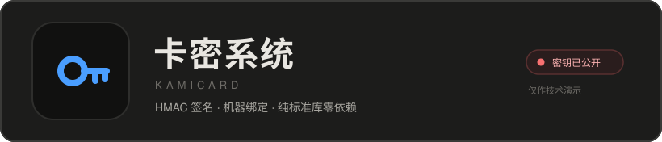
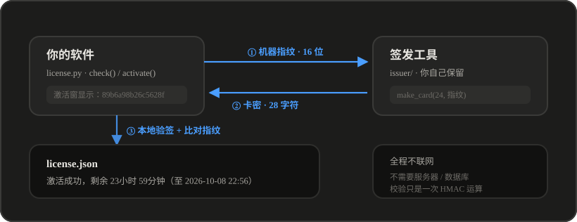

<p align="center">
  
</p>

<p align="center">
  <b>给你的软件加一道离线授权门</b><br>
  不联网 · 不要服务器 · 一机一码 · 限时到期
</p>

<p align="center">
  
  
  
  
  
</p>

<p align="center">
  <a href="#快速开始">快速开始</a> ·
  <a href="#工作原理">工作原理</a> ·
  <a href="#签发卡密">签发卡密</a> ·
  <a href="#接入你的软件">接入</a> ·
  <a href="#api-参考">API</a> ·
  <a href="#安全模型">安全模型</a> ·
  <a href="#常见问题">FAQ</a>
</p>

---

> [!WARNING]
> **本仓库是公开的，`issuer/` 里的主签发密钥也随之公开。**
> 任何看到这个仓库的人都能离线造出无限张有效卡密 —— 防伪造能力已失效
> （机器绑定、一卡一次、时长叠加仍然有效）。
>
> 这是仓库 owner 的明确选择，用作技术演示。**如果你打算真的靠卡密卖软件**：
>
> ```bash
> python tools/rotate_key.py                                    # 1. 换密钥
> gh repo edit --visibility private --accept-visibility-change-consequences  # 2. 转私有
> ```
>
> 转私有**不会**把密钥从 Git 历史抹掉 —— 公开过就必须假设已泄露，只能换密钥。
> 完整分析见 [安全说明.md](安全说明.md)。

---

## 这是什么

很多小工具想收费，但接一套授权系统意味着要租服务器、写后端、维护数据库 ——
成本远超软件本身。

这个项目的思路是**把授权信息全部塞进卡密本身**：

```
卡密 = 到期时间 + 目标机器指纹 + HMAC 签名        （17 字节，编码成 28 个字符）
```

于是校验只需本地算一次哈希 —— **不需要联网，不需要服务器，不需要数据库**。
整个客户端是一个 16KB 的 `license.py`，只用 Python 标准库。

用户把界面上的 16 位指纹发给你 → 你用签发工具生成一张卡密发回去 →
用户粘贴激活。**这张卡在别的电脑上是废纸。**

## 核心特性

|  | 特性 | 实现方式 |
|---|---|---|
| 🔌 | **完全离线** | 到期时刻和机器指纹内嵌在卡密里，校验纯本地运算 |
| 🔐 | **改一个字符就废** | HMAC-SHA256 签名 + 校验和，手输错和篡改都能区分 |
| 💻 | **一机一码** | 卡密里存目标机器指纹的哈希，换机激活直接拒 |
| 🎫 | **一卡一次** | 用过的卡哈希记进 `license.json`，重复激活被拒 |
| ⏱ | **按小时签发** | 1 小时卡到 10 年卡，精度到秒 |
| ➕ | **时长叠加** | 续期 = `max(现在, 旧到期) + 新卡时长`，先买 1 小时再补 1 天 = 25 小时 |
| 🛡 | **存档防篡改** | `license.json` 里的到期时间也被签名覆盖，改成 2099 年无效 |
| 🫥 | **不暴露「授权」概念** | 校验点分散 + `sentinel()`/`health()` 模糊返回，没有 `if not licensed` 可搜 |
| 📦 | **零依赖** | 客户端只用标准库，打包进 exe 不增加体积 |
| 📱 | **手机也能签卡** | 一个单文件 HTML，丢手机浏览器里就能签发 |

## 快速开始

```bash
git clone https://github.com/xiebrooooo/kamicard-license.git
cd kamicard-license

# 跑一遍自检（52 项，不需要联网）
python tests/test_license.py

# 验证 JS 签发器 与 Python 校验器 字节级一致
python tests/test_parity.py

# 打开签发工具
python issuer/card_tool.py
```

想要一张卡试试？给自己签一张 24 小时卡：

```python
import license as LIC
print(LIC.make_card(24, LIC.machine_id()))   # 24 小时卡，绑定本机
```

## 工作原理

<p align="center">
  
</p>

<details>
<summary><b>卡密的字节布局（点开）</b></summary>

<br>

| 偏移 | 长度 | 内容 |
|---:|---:|---|
| 0 | 4 | 到期时刻 —— Unix 时间戳，秒级（uint32 大端） |
| 4 | 4 | 机器指纹 —— 目标机器码 SHA-256 的前 4 字节 |
| 8 | 2 | 随机盐 —— 防止同规格卡生成出一模一样的字符串 |
| 10 | 2 | 功能位 —— uint16，`bit0` 预留 |
| 12 | 4 | 签名 —— `HMAC-SHA256(密钥, 前 12 字节)` 的前 4 字节 |
| 16 | 1 | 校验和 —— `sum(body + sig) & 0xFF` |

编码：17 字节 → Base32 → 28 个字符 → 每 4 位一组加连字符

```
NNFS-HAHT-PE2D-OERU-AAA3-UYMQ-QOSQ
```

比固定长度的 UUID 更长一点，但**自带到期时间和机器绑定**，且不需要任何外部查询。

</details>

## 签发卡密

三种方式，签出来的卡**完全通用**（算法同一套，已用 `tests/test_parity.py` 验证字节级一致）：

| 方式 | 命令 / 打开 | 适合场景 |
|---|---|---|
| 🖥 **桌面工具** | `python issuer/card_tool.py` | 日常签发，带签发记录存档 |
| 📱 **手机版** | 浏览器打开 `issuer/ui/card_tool_mobile.html` | 不在电脑前也能签，离线可用 |
| ⌨️ **命令行** | `LIC.make_card(小时数, 指纹)` | 批量签发、脚本集成 |

桌面工具可以打成 exe 随身带：

```bash
build_issuer.bat          # 产物：dist_issuer\卡密签发工具.exe
```

> [!CAUTION]
> 签发工具含**主密钥**，只能自己留着。发给谁 = 把整套卡密系统送给谁。

## 接入你的软件

```python
import pathlib, sys
sys.path.insert(0, r"path/to/kamicard-license")
import license as LIC

ROOT = pathlib.Path(__file__).resolve().parent   # license.json 存这里
LIC.set_root(ROOT)

# 1) 查状态
st = LIC.check(ROOT)
if st["status"] != LIC.OK:
    print("本机指纹：", LIC.machine_id())        # 让用户把指纹发给你
    print("当前状态：", st.get("remaining_text", "未激活"))

# 2) 激活
ok, msg = LIC.activate(ROOT, "NNFS-HAHT-PE2D-OERU-AAA3-UYMQ-QOSQ")
print(msg)   # "激活成功，剩余 23小时 59分钟（至 2026-10-08 22:56）"

# 3) 运行时巡检（放在业务循环里，零开销）
if not LIC.sentinel(ROOT):
    print("运行环境变化，功能已暂停")
```

带界面的话，`client/activate_ui.html` 是可直接复用的激活弹窗（自包含单文件，
无前端框架依赖）。后端只要暴露两个方法：

```python
class Api:
    def get_lic(self):        # 界面用它显示指纹和剩余时间
        ...
    def activate(self, card): # 界面用它提交卡密
        ...
```

完整可运行示例见 [`examples/integrate_example.py`](examples/integrate_example.py)，
防绕过建议和踩坑见 [接入指南.md](接入指南.md)。

## API 参考

### 客户端（打包进你的软件）

| 函数 | 说明 | 返回 |
|---|---|---|
| `set_root(path)` | 指定 `license.json` 所在目录 | — |
| `machine_id()` | 本机指纹（16 位十六进制） | `str` |
| `check(root)` | 查询授权状态 | `{status, remaining, remaining_text, expires_at}` |
| `activate(root, card)` | 用卡密激活 | `(ok: bool, msg: str)` |
| `sentinel(root, every=20)` | 运行期巡检，20 秒内只比对时间戳（零开销） | `bool` |
| `health()` | 模糊健康度，`1.0 / 0.5 / 0.0` | `float` |

`check()` 的 `status` 取值：

| 值 | 含义 | 建议处理 |
|---|---|---|
| `ok` | 正常 | 放行 |
| `missing` | 从未激活 | 引导激活 |
| `expired` | 已到期 | 引导续费 |
| `wrong_machine` | 存档来自别的机器 | 让用户重新激活 |
| `corrupt` | 卡密或存档被改过 | 让用户删掉 `license.json` 重来 |

### 签发端（自己留着）

| 函数 | 说明 |
|---|---|
| `make_card(hours, machine)` | 按「时长（小时）+ 目标指纹」签发一张卡 |
| `parse_card(card)` | 解析并验签，不碰本地存档 |
| `remaining_text(sec)` | 秒数 → `"1天 2小时"` 这类可读写法 |
| `remaining_seconds(card)` | 卡密剩余秒数，无效返回 `-1` |

## 安全模型

### 能挡住

- 改卡密里的日期 → HMAC 签名校验挡住
- 复制别人的 `license.json` → 机器指纹不匹配
- 用别台机器签的卡 → 指纹不匹配，直接拒
- 改 `license.json` 里的到期时间 → 存档签名对不上
- 搜一行代码注释掉绕过 → 校验点分散在启动、业务循环、激活入口三处，
  且对外不暴露「授权无效」这个概念

### 挡不住

- 反编译 exe 找密钥 —— **纯离线方案的固有局限：密钥必然躺在客户端里**
- 把系统时间往回调

> [!NOTE]
> 想要更强的保护，两条路：一是用 pyarmor 正式授权加密 `license.py` 再打包
> （见下方「打包加密」）；二是改成在线校验 —— 卡密只存 ID，客户端联网验签。
> 对几十到几百人规模的软件，当前这套通常够用。

## 常见问题

<details>
<summary><b>用户重装系统 / 换电脑了怎么办？</b></summary>

指纹会变，原卡失效。让用户把新指纹发给你，重新签一张。
这是「一机一码」的必然代价 —— 想允许换机就得改成在线校验。
</details>

<details>
<summary><b>能同时授权多台机器吗？</b></summary>

不能，当前是一卡一机。要做「一卡 N 机」需要多存几个指纹或加服务器。
</details>

<details>
<summary><b>卡密囤了半个月才激活，时长会缩水吗？</b></summary>

会。卡里的「时长」= `到期时刻 - 现在`，相当于假定签发后立刻激活。
店主签完马上发给用户的情况下误差只有几分钟；囤久了会少几天。
这是为了「一张卡自带完整信息」做的近似。
</details>

<details>
<summary><b>为什么不用 MAC 地址做机器码？</b></summary>

`uuid.getnode()` 在拿不到有效网卡时会返回**随机数**（第 41 位为 1），
同一台机器每次算出来的指纹都不一样，用户的卡会莫名其妙失效。
现在用的是 Windows MachineGuid + 系统盘序列号 + 主机名，重装系统才变。
</details>

<details>
<summary><b>Linux / macOS 能用吗？</b></summary>

能用，但**机器指纹会退化**：`_machine_guid()` 和 `_disk_serial()`
都是 Windows 专用的（读注册表 / 查物理盘序列号），在 Linux/macOS 上会失败并回退到
「仅主机名」—— 抗改机能力因此弱得多。

写 Windows 软件的话不受影响。需要在 Linux/macOS 上做强指纹，
可以补上 `/etc/machine-id`（Linux）和 `IOPlatformUUID`（macOS）。
</details>

<details>
<summary><b>轮换密钥要改几个地方？</b></summary>

两个：`license.py` 的 `_KEY` 和 `issuer/ui/card_tool_mobile.html` 的 `KEY` 数组。
手工改极容易只改一边，导致手机签的卡软件全不认 —— 用脚本一次搞定：

```bash
python tools/rotate_key.py            # 生成随机新密钥
python tools/rotate_key.py --dry-run  # 只预览
python tools/rotate_key.py --key aabbccddeeff0011223344556677
```

脚本会同时改写两个文件，并自动跑一遍一致性验证。

> [!WARNING]
> 轮换后**已发出的卡密全部失效**，老用户需要重新签发、重新激活。
</details>

## 项目结构

```
kamicard-license/
├── license.py                  ★ 核心：纯标准库，签发端与客户端共用同一份
├── client/
│   └── activate_ui.html          可复用激活弹窗（自包含单文件）
├── issuer/                       ⚠ 含签发密钥，不可外发
│   ├── card_tool.py              签发工具（桌面 GUI）
│   └── ui/
│       ├── card_tool.html        桌面端界面
│       └── card_tool_mobile.html 手机版签发器（单文件，纯 JS 实现同一套算法）
├── examples/
│   └── integrate_example.py      最小接入示例（可运行）
├── tools/
│   └── rotate_key.py             一键轮换密钥
├── tests/
│   ├── test_license.py           逻辑自检 52 项
│   ├── test_parity.py            跨语言一致性验证
│   └── test_js_parity.js         上面的 JS 侧
├── docs/
│   ├── logo.svg
│   └── flow.svg
├── build_issuer.bat              一键打包签发工具 exe
├── 接入指南.md                    接入步骤、防绕过建议、踩坑
├── 安全说明.md                    密钥公开的影响与处置
└── 卡密签发手册.txt                签发操作手册
```

## 测试

```bash
python tests/test_license.py    # 52 项：签发/激活/叠加/一卡一次/换机/过期/篡改/容错
python tests/test_parity.py     # JS 签发器 ↔ Python 校验器，字节级一致
```

`test_parity.py` 拦的是最容易出的事故：有人改了 `card_tool_mobile.html`
里的密钥或字段顺序，**只改了一边** —— 结果手机签的卡软件全都不认，
小批量测试根本发现不了。它用固定盐和固定时间戳签发，逐字节比对。

## 打包加密

`license.py` 约 16KB，可以顺手上 pyarmor 加密再打进 exe。

> [!IMPORTANT]
> pyarmor **试用版对单个 `.py` 有体积上限**（实测 30KB 以内较稳）。超了会报
> `ERROR out of license`，而且**不会让整个命令失败** —— 它会把那个文件原样拷过去，
> 只在日志里写一句 `is not obfuscated because out of license`。不留意就会以为加密成功了。
>
> 单文件快速排查：`pyarmor gen -O /tmp/t1 license.py`

另外，pyarmor 加密后 PyInstaller 静态分析看不到 `import`，需要一个**明文 `entry.py`**
把所有模块显式 import 一遍 —— 写法见 [接入指南.md](接入指南.md) 第八节。

## 许可

本仓库未附加开源许可证，默认**保留所有权利**。
可以阅读、学习、参考实现思路；商用或再分发请联系作者。

---

<p align="center">
  <sub>如果这个项目对你有帮助，点个 ⭐ 就是最好的支持</sub>
</p>
